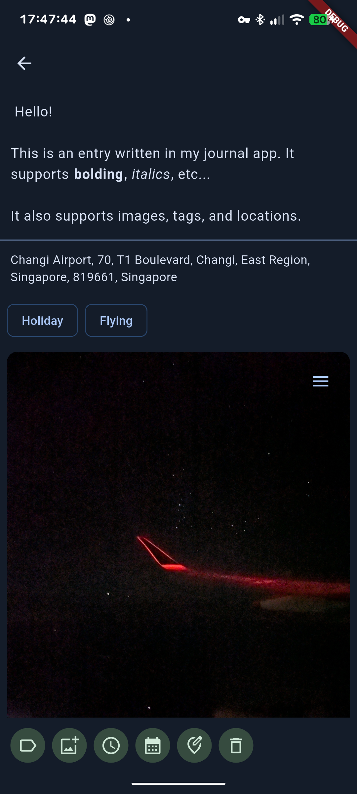

# Journal App
A journal app like some certain more premium paid options, but without any AI features, payment, or servers. It works on Android by storing your markdown files where you want them, and storing them with frontmatter (mostly) compatible with Obsidian. 

## Features
 - Images
 - Tags
 - Location data
 - Markdown editor

## Install
Get the latest release off the [releases page](https://github.com/owen-59/local-journal/releases) or [on Obtainium](https://apps.obtainium.imranr.dev/redirect?r=obtainium://app/%7B%0A%20%20%22id%22:%20%22com%2Eowen59%2Ejournal%22,%0A%20%20%22url%22:%20%22https://github%2Ecom/owen%2D59/local%2Djournal%22,%0A%20%20%22author%22:%20%22owen%2D59%22,%0A%20%20%22name%22:%20%22Journal%22%0A%7D%0A).

## Transitioning from Day One
This tool is very rough and does not support all Day One features.
 - Download your Day One data as JSON.
 - Use the tool at [owen-59/dayone2journal](https://github.com/owen-59/dayone2journal).

## Gallery

  
   
  

